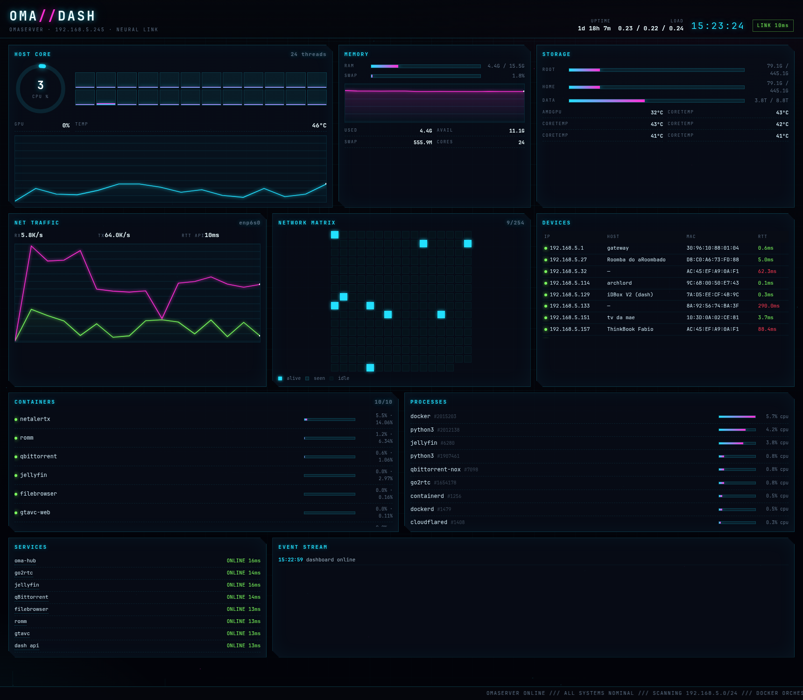
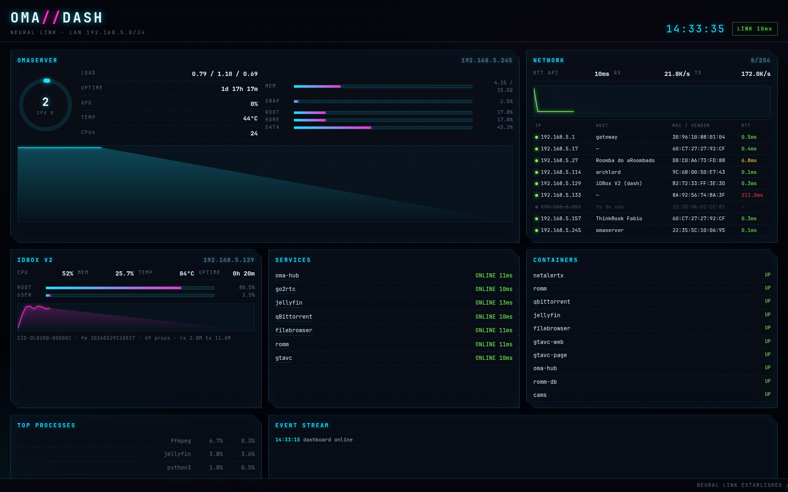
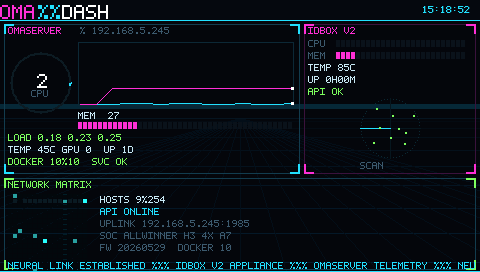
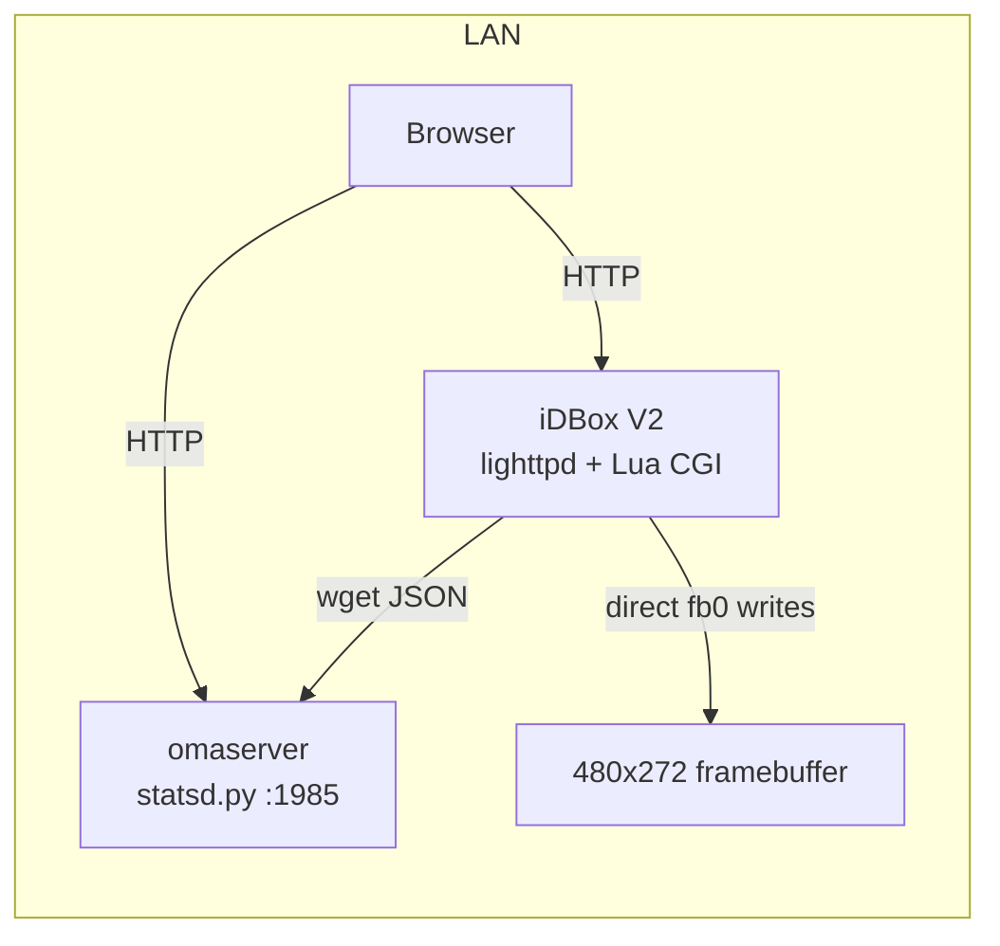

# OMA//DASH

Cyberpunk telemetry suite: a rich web dashboard for a Linux server, a compact
web dashboard for a tiny ARM appliance, and a native framebuffer status screen
for a 480×272 panel. No frontend frameworks, no CDN, no build step for the web
parts — plain HTML/CSS/JS plus a single Python stdlib HTTP server.



| iDBox web dashboard | iDBox framebuffer |
|---|---|
|  |  |

## What it shows

- **Host core** — CPU ring + per-thread bars, load average, uptime, GPU busy, hottest sensor, CPU history chart.
- **Memory** — RAM/SWAP usage, available, memory history chart.
- **Storage** — per-mount usage bars, temperatures per sensor.
- **Net traffic** — live RX/TX area chart for the uplink interface, API round-trip time.
- **Network matrix** — a 16×16 grid covering a /24: live hosts light up; host table with MAC, vendor, hostname and RTT.
- **Containers** — `docker ps -a` (stopped first) with CPU%/MEM% from `docker stats`, **start/stop buttons** and an audit log (`actions.log`).
- **Processes** — top processes by CPU with relative bars.
- **Services** — HTTP health checks with latency for a configurable list.
- **Disk health** — SMART per disk (PASSED/FAILED, temperature, power-on hours, reallocated sectors), refreshed daily by `disks-health.py` (systemd timer, smartctl in a container so it needs no root on the host).

## Architecture



- `server/statsd.py` — stdlib HTTP server: serves the dashboard statically and
  exposes JSON telemetry. Background threads sample `/proc` every 2 s and
  `docker stats` every 6 s.
- `server/www/` — the omaserver dashboard (the big one).
- `idbox-web/` — the small dashboard served by lighttpd on the appliance.
- `idbox-lcd/fbdash.c` — static ARM binary drawing straight into `/dev/fb0`
  (BGR24), with its own 5×7 font, perspective grid, scanline, radar, matrix,
  sparklines and glitch effects.
- `idbox-local/dash-local.lua` — Lua CGI returning the appliance's own
  `/proc` telemetry as JSON.

## Quick start (server)

```bash
sudo install -d /home/server/dash/www
sudo cp server/statsd.py /home/server/dash/statsd.py
sudo cp server/www/* /home/server/dash/www/
```

Edit the constants at the top of `statsd.py` (`PORT`, `LAN_IP`, `IFACE`,
`SERVICES`, `HOSTNAMES`, `OURS`) for your network, then:

```bash
mkdir -p ~/.config/systemd/user
cp systemd/oma-dash.service ~/.config/systemd/user/
systemctl --user daemon-reload
systemctl --user enable --now oma-dash.service
```

Open `http://<server>:1985/`. If a firewall is enabled, allow the port:

```bash
sudo ufw allow from 192.168.5.0/24 to any port 1985 proto tcp
```

### API

| Endpoint | Payload |
|---|---|
| `/` | dashboard |
| `/stats` | host, cpu, cores, mem, swap, disks, temps, gpu, docker (+`docker_all`), `disk_health`, health, procs, history |
| `POST /api/containers/<name>/(start\|stop\|restart)` | starts/stops a container, appends `time · ip · action · name` to `actions.log` |
| `/history` | ring buffers (120 × 2 s): `ts`, `cpu`, `mem`, `rx`, `tx` |
| `/network` | alive/total plus devices (ip, mac, vendor, host, ports, rtt, rtt history) |
| `/health` | liveness probe |
| `/screen.txt` | compact feed for the iDBox LCD panel (480x272) |

All JSON responses send `Access-Control-Allow-Origin: *`.

## Quick start (iDBox / lighttpd appliance)

The small dashboard is a static site plus one CGI:

```bash
# copy idbox-web/* to the lighttpd document root
scp idbox-web/{index.html,style.css,app.js} root@device:/var/www/

# device-local JSON at /api/local
scp idbox-local/dash-local.lua root@device:/usr/bin/dash-local
ssh root@device 'chmod 755 /usr/bin/dash-local'
```

Then add to lighttpd (e.g. `conf.d/cgi.conf`):

```
$HTTP["url"] == "/api/local" {
  alias.url = ( "/api/local" => "/usr/bin/dash-local" )
  cgi.assign = ( "" => "" )
  cgi.execute-x-only = "enable"
}
```

If the firmware resolves `/` to `pt_BR/html/login.html`, symlink it to your
`index.html`.

## LCD renderer

```bash
cd idbox-lcd
make                 # cross-compiles a static armv7 binary via Docker
scp fbdash root@device:/mnt/fs_user/fbdash
ssh root@device 'chmod +x /mnt/fs_user/fbdash; /mnt/fs_user/fbdash &'
```

`fbdash.c` targets a 480×272, 24 bpp framebuffer with a 180°-mounted panel
(handled by `rot180`). Edit the URLs/constants near the top of `collect()`
for your host. A sample init script is in `idbox-lcd/fbdash.init`.

## Notes

- No authentication is included; restrict access at the firewall/LAN level.
- The dashboard expects a Linux host with `/proc`, `docker` and `curl`.
- Screenshots contain private LAN addresses from the author's network; they are
  not routable from the internet.

## License

MIT — see [LICENSE](LICENSE).
