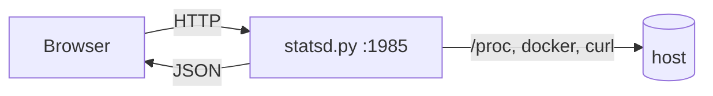

# OMA//DASH

Cyberpunk telemetry dashboard for a Linux server: one Python stdlib HTTP server
that serves a static dashboard and exposes live JSON metrics. No frameworks,
no CDN, no build step.


## Features

- **Host core** — CPU ring, per-thread bars, load average, uptime, GPU busy, hottest sensor, CPU history.
- **Memory** — RAM/SWAP usage and history chart.
- **Storage** — per-mount usage and temperature sensors.
- **Net traffic** — live RX/TX area chart for the uplink interface and API RTT.
- **Network matrix** — 16×16 grid covering a /24, plus a device table with MAC, vendor, hostname and latency.
- **Containers** — `docker ps` state and per-container CPU%/MEM% from `docker stats`.
- **Processes** — top processes by CPU with relative bars.
- **Services** — HTTP health checks with latency for a configurable list.
- **Event stream** — transitions (service down/up, container down/up, API loss).

## Architecture



- `server/statsd.py` — HTTP server: static dashboard plus JSON telemetry.
  A sampler thread reads `/proc` every 2 s; `docker stats` refreshes every 6 s;
  a ping sweep of the /24 runs every 25 s.
- `server/www/` — the dashboard (plain HTML/CSS/JS, canvas charts).

## Quick start

```bash
sudo install -d /home/server/dash/www
sudo cp server/statsd.py /home/server/dash/statsd.py
sudo cp server/www/* /home/server/dash/www/
```

Edit the constants at the top of `statsd.py` (`PORT`, `LAN_IP`, `IFACE`,
`SERVICES`, `HOSTNAMES`, `OURS`) for your network, then:

```bash
mkdir -p ~/.config/systemd/user
cp systemd/oma-dash.service ~/.config/systemd/user/
systemctl --user daemon-reload
systemctl --user enable --now oma-dash.service
```

Open `http://<server>:1985/`. If a firewall is enabled:

```bash
sudo ufw allow from 192.168.5.0/24 to any port 1985 proto tcp
```

## API

| Endpoint | Payload |
|---|---|
| `/` | dashboard |
| `/stats` | host, cpu, cores, mem, swap, disks, temps, gpu, docker (+stats), health, procs, history |
| `/history` | ring buffers (120 × 2 s): `ts`, `cpu`, `mem`, `rx`, `tx` |
| `/network` | alive/total plus devices (ip, mac, vendor, host, ports, rtt, rtt history) |
| `/health` | liveness probe |

All JSON responses send `Access-Control-Allow-Origin: *`.

## Notes

- No authentication; restrict access at the firewall/LAN level.
- Expects a Linux host with `/proc`, `docker` and `curl`.

## License

MIT — see [LICENSE](LICENSE).
