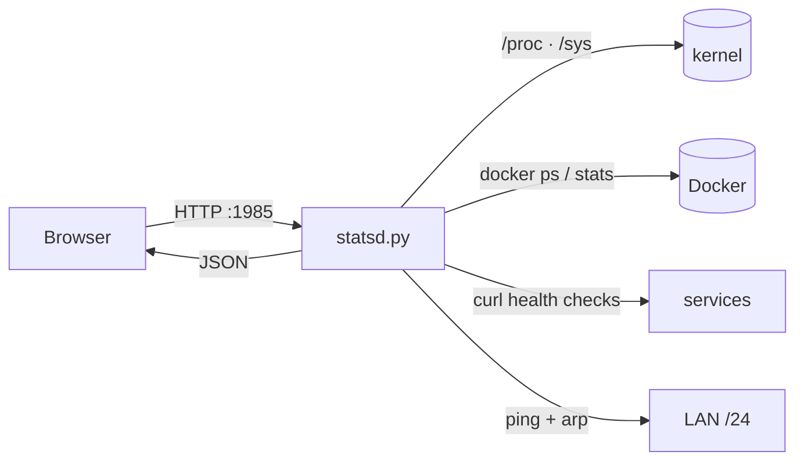

# OMA//DASH

**Cyberpunk telemetry for Linux servers.** One Python file, zero dependencies, no build step — a live dashboard for CPU, memory, storage, network, Docker, processes and service health, with an aesthetic that belongs in a neon-lit control room.


`python3` + `/proc` + `docker` + `curl`. That's the whole stack.

---

## Features

| Panel | What you get |
|---|---|
| **Host core** | CPU ring + per-thread bars, load average, uptime, GPU busy, hottest sensor, CPU history |
| **Memory** | RAM/SWAP usage, available, history chart |
| **Storage** | Per-mount usage bars, per-sensor temperatures |
| **Net traffic** | Live RX/TX area chart for the uplink interface, API round-trip time |
| **Network matrix** | 16×16 grid covering a /24 — live hosts light up; device table with MAC, vendor, hostname, latency |
| **Containers** | `docker ps` state + per-container CPU% and MEM% from `docker stats` |
| **Processes** | Top processes by CPU with relative bars |
| **Services** | Parallel HTTP health checks with latency |
| **Event stream** | Transitions: service up/down, container up/down, API loss |

- Sampler thread reads `/proc` every **2 s**; `docker stats` every **6 s**; LAN sweep every **25 s**.
- Server-side ring buffers (120 samples) so charts are populated for every new client.
- Plain HTML/CSS/JS + canvas. No framework, no CDN, no telemetry.

---

## Architecture



`statsd.py` serves the static dashboard and the JSON API from the same port.

---

## Quick start

```bash
sudo install -d /home/server/dash/www
sudo cp server/statsd.py /home/server/dash/statsd.py
sudo cp server/www/* /home/server/dash/www/
```

Edit the constants at the top of `statsd.py`:

| Constant | Purpose |
|---|---|
| `PORT` | HTTP port (default `1985`) |
| `LAN_IP` | IP used for health checks and the self entry |
| `IFACE` | Uplink interface shown in the traffic chart |
| `SERVICES` | `(name, url)` list for the health panel |
| `HOSTNAMES` / `OURS` | Friendly names and MAC vendor hints |

Then install the user service:

```bash
mkdir -p ~/.config/systemd/user
cp systemd/oma-dash.service ~/.config/systemd/user/
systemctl --user daemon-reload
systemctl --user enable --now oma-dash.service
```

Open `http://<server>:1985/`.

If a firewall is enabled:

```bash
sudo ufw allow from 192.168.5.0/24 to any port 1985 proto tcp
```

---

## API

| Endpoint | Description |
|---|---|
| `GET /` | dashboard |
| `GET /stats` | host, cpu, cores, mem, swap, disks, temps, gpu, docker (+stats), health, procs, history |
| `GET /history` | ring buffers, 120 × 2 s: `ts`, `cpu`, `mem`, `rx`, `tx` |
| `GET /network` | `alive`, `total`, devices: ip, mac, vendor, host, ports, rtt, rtt history |
| `GET /health` | liveness probe |

All JSON responses are `Access-Control-Allow-Origin: *` and `Cache-Control: no-store`.

```bash
curl -s http://192.168.5.245:1985/stats | jq '{cpu, load, mem}'
curl -s http://192.168.5.245:1985/network | jq '.devices[] | select(.alive)'
```

---

## Notes

- **No authentication.** Keep it on a trusted LAN or put it behind a reverse proxy with auth.
- Requires Linux with `/proc`, Docker (optional) and `curl` (for health checks).
- `docker` access: the user running the service must be in the `docker` group.
- The LAN sweep uses `ping` and `ip neigh`; devices that ignore ICMP stay cached as *seen*.
- Tested on Arch/Omarchy with Python 3.13, Docker 28, 24-thread Xeon + RADV GPU.

---

## License

MIT — see [LICENSE](LICENSE).
